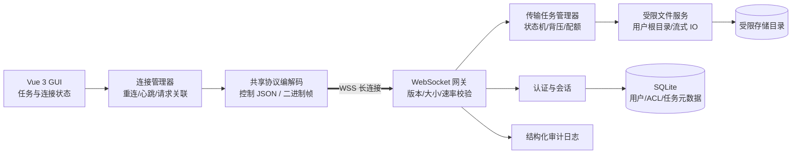
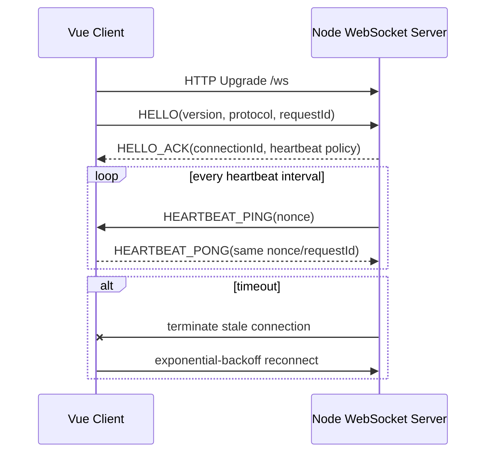
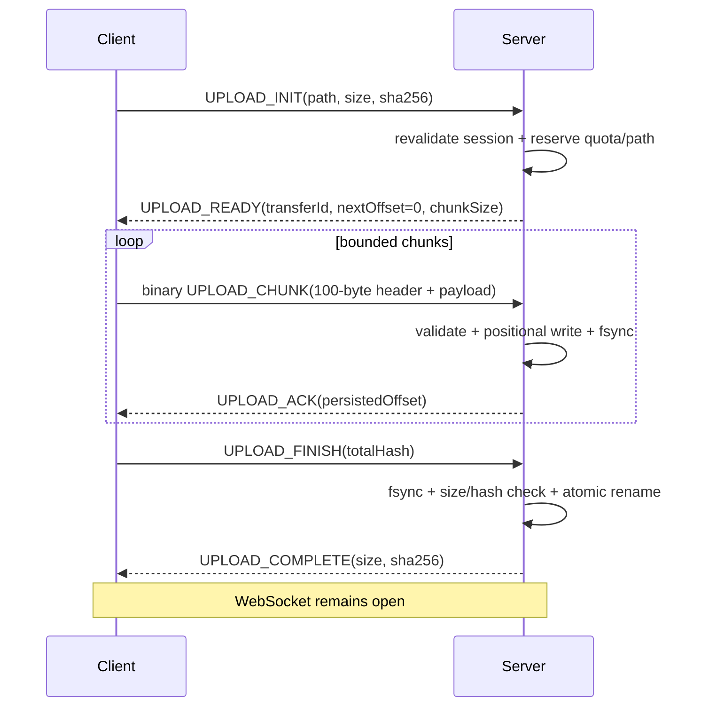

# 系统架构说明（更新至 Phase 2.3）

## 1. 技术选择与结论

采用 Vue 3 + TypeScript + Vite + Element Plus 的浏览器 GUI，Node.js + TypeScript + Express + `ws` 的服务端，SQLite 作为后续元数据库。这个 Web 路线符合讲义第 34–35、63 页的明确建议，也能在 Windows 11 上低成本编译和演示。

WebSocket 只提供双向长连接和消息边界，不等于文件传输协议。其上定义 `SFTP-WS v1`：控制面使用有统一逻辑头的 JSON 文本消息，数据面使用固定二进制头 + 小型 JSON 元数据 + 二进制分块。上传和下载不会使用 Express/Multer 之类的 HTTP 上传 API。

Phase 1 的本机开发链路是 `ws://`，只验证协议协商和心跳；最终安全结论必须建立在 Phase 3 的 `wss://`、可信证书验证、认证和安全测试之上。

## 2. 逻辑架构



Phase 2.3 已落地 UI、连接管理、共享控制/二进制协议、WebSocket 网关、认证/会话、SQLite 用户元数据、受限文件列表，以及单文件上传和下载状态机。TLS 仍是后续阶段边界。

## 3. 运行时与目录边界

```text
secure-file-transfer/
├─ apps/
│  ├─ client/                 Vue GUI；不直接接触服务器文件系统
│  └─ server/                 HTTP 健康检查 + WebSocket 协议端点
├─ packages/
│  └─ protocol/               两端共享的协议常量、类型、校验与编解码
├─ docs/                      需求、架构、协议、阶段计划
├─ data/                      运行时数据库（忽略提交，后续创建）
├─ storage/                   服务端受限文件根（忽略提交，后续创建）
├─ certs/                     本地证书/私钥（忽略提交，后续创建）
├─ .env.example               非秘密配置示例
└─ package.json               npm workspaces 与统一脚本
```

计划中的存储布局为 `storage/users/<opaque-user-id>/`。客户端提供的名称永远不是宿主路径；服务端将其解析为受控相对路径，规范化、检查根目录包含关系、拒绝重解析点逃逸后才打开文件。应用账户只获得 `storage/` 所需权限，不应拥有源码、系统目录或其他用户目录的写权限。

## 4. 连接与并发模型

- 一个浏览器会话维护一条 WebSocket 长连接，可在其上复用多个 `requestId` 和 `transferId`。
- 服务端为每条连接维护独立的协商、认证、心跳、限流和任务状态；不同用户不能共享可变会话对象。
- Node.js 事件循环处理大量连接，文件 IO 使用异步流；CPU 密集型摘要在流式读取时增量计算，必要时移至 worker pool。
- Phase 2.2 默认每个连接/用户只允许 1 个上传，服务器还有全局任务上限；初始化在进程内互斥区预留字节数、文件数和目标路径，防止并发绕过配额。
- 客户端只保留一个未确认块，服务器写入并 `fsync` 后才 ACK，天然提供上传背压。
- 连接断开会取消当前上传、释放预留并删除临时文件；不以断开作为文件结束信号。断点恢复留到 Phase 4。
- 下载同样默认每个用户/连接 1 个任务，只有一个未确认块；ACK 超时、断线和取消关闭只读句柄。合法下载 ACK 由服务端发送节奏约束，不计入通用控制消息速率，但仍受队列、状态和偏移校验约束。

## 5. 关键流程

### Phase 1 连接与心跳



### Phase 2.2 单文件上传流程（已实现）



### Phase 2.3 单文件下载流程（已实现）

```mermaid
sequenceDiagram
    participant C as Client
    participant S as Server
    C->>S: DOWNLOAD_INIT(logical path)
    S->>S: session/path check + safe open + streaming hash
    S-->>C: DOWNLOAD_READY(transferId, size, hash, chunkSize)
    loop one outstanding chunk
        S-->>C: binary DOWNLOAD_CHUNK(100-byte header + payload)
        C->>C: chunk hash + bounded write
        C->>S: DOWNLOAD_ACK(nextOffset)
    end
    S->>S: sent hash + source identity recheck
    S-->>C: DOWNLOAD_FINISH(size, hash)
    C->>C: whole-file size/hash check
    C->>S: DOWNLOAD_COMPLETE(result)
    S-->>C: DOWNLOAD_COMPLETE(accepted=true)
    Note over C,S: only now deliver verified file; WebSocket remains open
```

## 6. Web 路线满足性与风险

| 关注点 | 为什么可满足 | 主要风险 | 对策 |
| --- | --- | --- | --- |
| 长连接 | WebSocket 是持续的全双工 TCP/TLS 会话 | 代理空闲超时、浏览器后台定时器节流、网络切换 | 服务端主导应用层心跳、超时清理、指数退避重连；部署代理超时大于心跳周期 |
| 自定义协议 | WebSocket 上可传文本和二进制消息，且保留消息边界 | 把 WebSocket 消息误当完整协议、只做 HTTP 上传 | 独立共享协议包、版本/类型/请求/任务/偏移/长度/错误/摘要字段及状态机；文件只走 WS 数据帧 |
| 安全性 | WSS 复用成熟 TLS；Node 有成熟认证、KDF 和 SQLite 库 | `ws://` 开发配置误入生产、证书校验被关闭、Origin/CSRF、DoS、大消息、依赖供应链 | 生产强制 WSS/HSTS、可信 CA、Origin allowlist、鉴权后授权、多层限额、禁用压缩、锁文件和依赖审计 |
| GUI | Vue + Element Plus 能提供登录、文件浏览、进度和任务管理 | 浏览器无法直接读取任意本地路径、刷新丢失 UI 状态 | 用 File API/拖放选择；任务状态由服务端持久化并可重查；需要桌面集成时再考虑 Electron |
| 大文件 | Blob/ArrayBuffer 与 Node streams 可流式分块 | 浏览器若对大文件调用一次性 `arrayBuffer()` 会爆内存 | 对 `File.slice()` 分块，限制 chunk 大小和发送缓冲，服务端流式写入与增量哈希 |
| Windows | Node/Vite 跨平台且无需本机 C++ 工具链 | Windows 路径大小写、反斜杠、保留名和 NTFS 重解析点 | 服务端只接受 POSIX 风格逻辑相对路径；Windows 专项路径/ACL 测试和 PowerShell 初始化脚本 |
| 多用户并发 | 单连接复用多任务，服务端异步 IO | 一个用户占满连接、带宽、磁盘或事件循环 | 用户/连接/任务三级配额，令牌桶限速、公平调度、背压与超时 |

## 7. 安全边界和信任模型

- 不信任浏览器输入、文件名、声明大小、偏移、摘要、令牌、Origin 和所有协议字段。
- TLS 保护传输机密性与服务器身份，但不替代应用层认证、授权、审计或端到端文件摘要。
- SHA-256 用于内容完整性检测，不充当密码哈希或身份认证。
- SQLite 参数化查询只解决 SQL 结构注入，还需最小数据库权限、输入限制和事务边界。
- 应用层限流缓解资源耗尽但不能单机“彻底抵御 DDoS”；最终报告应准确表述为反向代理/防火墙、连接限额和应用配额的分层缓解。

## 8. 配置与秘密管理

`.env.example` 只含非秘密默认值。真实 `.env`、数据库、存储内容、证书和私钥全部被 `.gitignore` 排除。Phase 3 将提供开发 CA/证书生成说明，但绝不提交私钥；生产从环境或秘密管理设施加载密钥，并拒绝缺少 TLS 的生产启动。

## 9. Phase 2.1 持久化与隔离实现

- SQLite 使用静态 SQL migration 和 Node.js 22.5+ 内置 `node:sqlite`；动态值全部通过 prepared statement 参数绑定。Node 22 会显示 SQLite experimental warning，这是已知运行时提示，不影响当前验证，升级 Node LTS 时应复核 API 稳定性。
- `users` 保存 Argon2id PHC 哈希、公开用户资料和配额；`sessions` 保存随机 Token 的 SHA-256 查找值、有效期和撤销时间，不保存原始 Token。
- 服务端连接只保存内部 `sessionId`。任何受保护操作都重新读取数据库，因而退出、过期或后台撤销会立即生效。
- 存储布局为 `storage/users/<server-issued-uuid>/`。路径接口只接受 `/` 分隔的逻辑相对路径，拒绝绝对路径、反斜杠、`.`、`..`、NUL、Windows 保留名及符号链接/目录联接。
- Phase 2.2 上传复用受控创建路径接口；临时文件位于 `storage/.upload-tmp/<user-id>/`，不会出现在用户文件列表中。启动时清理上次进程异常退出留下的临时目录。

## 10. Phase 2.2 持久写入和原子提交

- 浏览器使用 `File.slice()` 增量计算整文件摘要并按默认 256 KiB 分块，服务端用 `FileHandle.write` 循环处理短写，不缓存完整文件。
- 每块验证协议长度、任务归属、声明大小、严格顺序偏移和 SHA-256；成功写入并 `fsync` 后才返回 ACK。
- 完成时再次核对累计字节、临时文件实际大小和整文件增量 SHA-256，然后关闭句柄。
- Windows/Unix 均使用同卷硬链接创建最终文件，以原子且不覆盖的方式解决并发同名冲突；成功后删除临时链接，并尽力对目录执行 `fsync`。目标已存在则安全失败。
- 错误摘要、大小不符、非法块、取消、会话失效或断线都会关闭句柄、删除临时文件并释放配额预留，不会产生可见残缺文件。
- 配额预留和活跃任务表目前是单进程内状态；若未来部署多个服务实例，必须迁移到共享事务/租约存储后才能保证跨实例一致性。

## 11. Phase 2.3 一致性、背压和浏览器落盘

- 服务端通过受控相对路径解析后打开只读句柄；在 `DOWNLOAD_READY` 前用有界缓冲区计算 SHA-256，并比较散列前后句柄与路径的设备、inode、大小、mtime/ctime。
- 传输时再次增量计算实际发送内容摘要。最后一块 ACK 后重新比较打开句柄和当前路径身份；删除、替换、截断或修改均产生 `SOURCE_CHANGED`，不会发送成功完成。
- 默认 256 KiB 且只允许一个未 ACK 块，避免 WebSocket 发送缓冲无限增长。ACK/完成确认有 15 秒默认超时。
- Edge/Chrome 主路径先流式写入浏览器 OPFS 临时文件，整文件 SHA-256 和服务端确认通过后，再有界流式复制到用户通过 File System Access API 选择的文件；不在 JavaScript 堆中保存完整大文件。
- 不支持 File System Access API 的浏览器采用显式限制为 32 MiB 的 Blob 兼容路径；更大文件被拒绝并提示使用 Edge/Chrome。这一兼容模式会占用与文件大小相当的内存。
- 浏览器无法为普通网页提供跨浏览器原子重命名。主路径在校验成功前不向目标写内容，但最终复制失败可能留下空文件或部分目标；界面会报告失败，OPFS 临时文件会清理。

