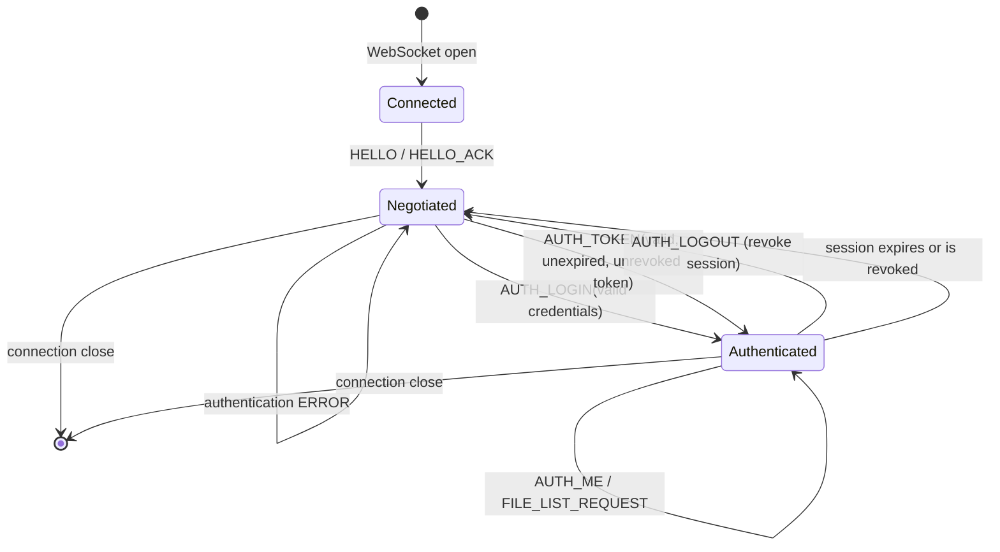
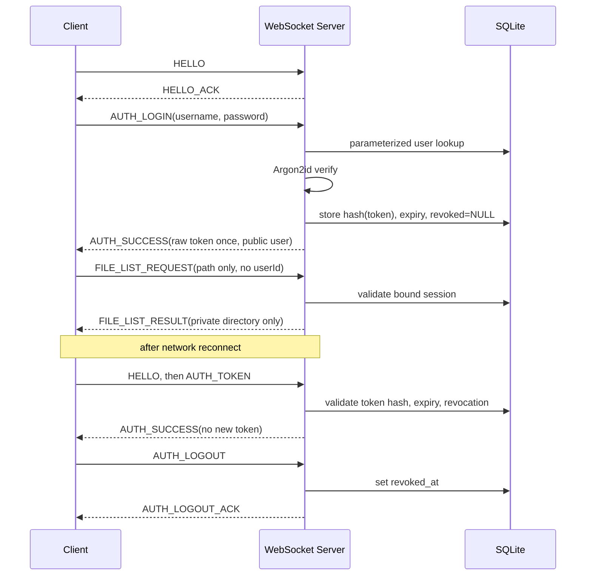
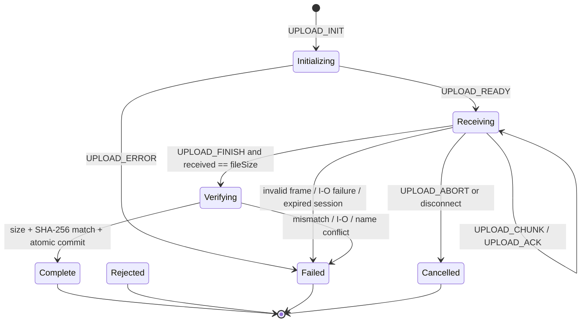

# SFTP-WS v1 应用层协议草案

状态：**Draft / Phase 2.2 authentication and single-file upload subsets implemented**。名称 `SFTP-WS` 仅为本实验协议名，不应与 SSH File Transfer Protocol（通常也缩写 SFTP）混淆；最终报告可改用更不易混淆的 `UCAS-SFT/1`。

## 1. 设计目标

- 在一条长期 WSS 连接上复用控制请求和多个文件任务。
- 明确消息边界、文件大小、偏移和完成确认，不以断开连接表示 EOF。
- 能关联请求、任务和错误，支持重试、重连、并发与后续断点续传。
- 文件分块流式传输，接收端可限制资源并施加背压。
- TLS 保护线路；每块和整文件 SHA-256 发现内容损坏或错误拼接。

## 2. WebSocket 映射

WebSocket 每条 message 对应一个 `SFTP-WS` frame，不允许一个协议 frame 横跨多个 WebSocket message。底层 WebSocket 自身可能进行帧分片，库负责重组；业务层只处理完整 message。

- **文本 message**：控制帧，UTF-8 JSON；上限 64 KiB。
- **二进制 message**：100 字节固定头 + `metadataLength` 字节 UTF-8 JSON + `payloadLength` 字节原始数据。
- 禁用 `permessage-deflate`，避免压缩资源消耗和敏感信息压缩侧信道；文件本身常已压缩。

## 3. 控制帧逻辑头

```json
{
  "version": 1,
  "type": "HEARTBEAT_PING",
  "requestId": "550e8400-e29b-41d4-a716-446655440000",
  "timestamp": 1794384000000,
  "payload": { "nonce": "b510..." }
}
```

| 字段 | 类型 | 约束与语义 |
| --- | --- | --- |
| `version` | integer | 当前为 1；在 `HELLO` 阶段协商，不兼容版本拒绝连接 |
| `type` | enum string | 消息类型；未知类型返回 `UNSUPPORTED_MESSAGE` |
| `requestId` | string | 1–128 个白名单字符；请求与响应相同；事件使用新 ID |
| `timestamp` | non-negative safe integer | 发送端 Unix epoch 毫秒，用于审计，不单独作为重放防护 |
| `payload` | object | 按消息类型校验，拒绝缺字段、错类型和超限值 |

Phase 1 已实现：`HELLO`、`HELLO_ACK`、`HEARTBEAT_PING`、`HEARTBEAT_PONG`、`ERROR`。

Phase 2.1 已增加：`AUTH_LOGIN`、`AUTH_TOKEN`、`AUTH_SUCCESS`、`AUTH_LOGOUT/ACK`、`AUTH_ME/RESULT`、`FILE_LIST_REQUEST/RESULT`。文件列表是受保护的控制请求，不是文件内容传输。

Phase 2.2 已增加：`UPLOAD_INIT`、`UPLOAD_READY`、`UPLOAD_ACK`、`UPLOAD_FINISH`、`UPLOAD_COMPLETE`、`UPLOAD_ABORT/ABORTED`、`UPLOAD_ERROR`，以及二进制 `UPLOAD_CHUNK`。下载消息留到 Phase 2.3。

### 3.3 单文件上传控制消息

| 消息 | 方向 | payload | 语义 |
| --- | --- | --- | --- |
| `UPLOAD_INIT` | C→S | `{ path, fileSize, fileSha256 }` | 申请上传；摘要为 64 位十六进制 SHA-256 |
| `UPLOAD_READY` | S→C | `{ transferId, chunkSize, nextOffset }` | 服务端完成鉴权、路径、配额、磁盘和任务限额检查；Phase 2.2 的 `nextOffset` 恒为 0 |
| `UPLOAD_ACK` | S→C | `{ transferId, persistedOffset, chunkLength }` | 当前块已经写入并 `fsync`，`persistedOffset` 是下一预期偏移 |
| `UPLOAD_FINISH` | C→S | `{ transferId }` | 客户端声明已发送完，不能代替服务端大小/摘要校验 |
| `UPLOAD_COMPLETE` | S→C | `{ transferId, path, fileSize, fileSha256 }` | 临时文件校验并原子提交成功 |
| `UPLOAD_ABORT` | C→S | `{ transferId }` | 取消任务并清理临时文件/配额预留 |
| `UPLOAD_ABORTED` | S→C | `{ transferId }` | 取消清理已经完成 |
| `UPLOAD_ERROR` | S→C | `{ code, message, retryable, transferId? }` | 上传专用规范错误；不泄露宿主路径或堆栈 |

所有上传控制请求仍使用逻辑头中的 `requestId` 做请求/响应关联。服务端不接受客户端提供 `userId`；任务所有者来自当前有效会话。

### 3.1 认证状态机



- 客户端不能提供或选择 `userId`；服务端从参数化查询得到用户，再把 `sessionId` 绑定到连接状态。
- 原始 256 位随机 Token 只返回一次，数据库只保存 Token 的 SHA-256 查找值；密码只保存 Argon2id PHC 字符串。
- 每次 `AUTH_ME`、`FILE_LIST_REQUEST` 及未来文件操作都重新从 SQLite 检查会话有效期和撤销状态，不只检查连接内布尔值。
- 断线不会自动撤销 Token，以支持短期重连；新 WebSocket 完成 HELLO 后必须发送 `AUTH_TOKEN` 重新验证。
- `AUTH_LOGOUT` 撤销数据库会话并把连接退回未认证状态。

### 3.2 登录、重连和退出时序



## 4. 二进制数据帧固定头（网络字节序，大端）

```text
 0                   1                   2                   3
 0 1 2 3 4 5 6 7 8 9 0 1 2 3 4 5 6 7 8 9 0 1 2 3 4 5 6 7 8 9 0 1
+-------------------------------+-------+-------+---------------+
|            Magic              | Ver   | HLen  |  MessageType  |
+---------------+---------------+--------------------------------+
|     Flags     |   ErrorCode   |      Request ID (16 bytes) ... |
+---------------+---------------+--------------------------------+
| Request ID ...                |      Transfer ID (16 bytes) ...|
+---------------------------------------------------------------+
| Transfer ID ...                                               |
+---------------------------------------------------------------+
|                     File Size (uint64)                         |
+---------------------------------------------------------------+
|                     Offset (uint64)                            |
+-------------------------------+-------------------------------+
|      Payload Length (u32)     |      Metadata Length (u32)    |
+---------------------------------------------------------------+
|                Payload SHA-256 (32 bytes)                      |
+---------------------------------------------------------------+
|                     ... (total header 100 bytes)               |
+---------------------------------------------------------------+
```

| Offset | 长度 | 字段 | 说明 |
| ---: | ---: | --- | --- |
| 0 | 4 | magic | ASCII `SFT1`，快速拒绝错协议 |
| 4 | 1 | version | `1` |
| 5 | 1 | headerLength | 固定 `100`；为后续扩展保留 |
| 6 | 2 | messageType | Phase 2.2 的 `0x0201` 表示 `UPLOAD_CHUNK` |
| 8 | 2 | flags | Phase 2.2 要求 `ACK_REQUIRED=0x0001`；`FINAL=0x0002` 已保留但不作为完成依据 |
| 10 | 2 | errorCode | 成功为 0；错误码命名空间，数据帧通常为 0 |
| 12 | 16 | requestId | UUID 的 128 位二进制形式；全零表示无请求关联 |
| 28 | 16 | transferId | 服务端签发的任务 UUID；初始化前为全零 |
| 44 | 8 | fileSize | 声明的整文件字节数；`uint64`，受服务端配额上限约束 |
| 52 | 8 | offset | 本 payload 在文件中的绝对字节偏移 |
| 60 | 4 | payloadLength | 当前原始数据长度，不得超过协商 chunk 上限 |
| 64 | 4 | metadataLength | 紧随头部的 JSON 元数据长度，设置小上限 |
| 68 | 32 | payloadSha256 | 当前 payload 的 SHA-256；无 payload 时为全零 |

总消息长度必须严格等于 `headerLength + metadataLength + payloadLength`。解析器先验证魔数、版本、长度和上限，再分配/读取正文；任何整数溢出、长度不一致、偏移越界或摘要不符均拒绝。

### 4.1 Phase 2.2 `UPLOAD_CHUNK` 约束

- 固定头中的 `requestId`、`transferId` 均为 UUID 的 16 字节网络表示。
- `metadataLength` 必须为 0，`errorCode` 必须为 0，`payloadLength` 必须为 `1..chunkSize`。零字节文件不发送数据帧。
- `fileSize` 必须等于初始化声明值；`offset` 必须等于上一次 ACK 的 `persistedOffset`。
- `payloadSha256` 必须等于当前 payload 的 SHA-256；服务端使用常量时间比较。
- 服务端严格检查 WebSocket message 总长度等于 `100 + metadataLength + payloadLength`，最大 metadata 为 8 KiB，默认 payload 为 256 KiB，配置范围 16 KiB–1 MiB。

## 5. 单文件上传状态机与不变量



关键不变量：

1. 未成功认证的连接不能创建文件任务。
2. `transferId` 只属于一个已认证用户和创建它的连接；Phase 2.2 不支持跨连接恢复或冒用。
3. 顺序模式下仅接受 `offset == acknowledgedOffset`；重复、跳跃和乱序块会使当前任务失败并清理临时文件。
4. `offset + payloadLength <= fileSize`，所有运算先检查溢出。
5. 只有精确收到 `fileSize` 字节且整文件 SHA-256 匹配，临时文件才以“不覆盖”方式原子提交并发送 `UPLOAD_COMPLETE`。
6. `ERROR.retryable` 只表示协议建议；客户端仍执行有次数上限和退避的重试。
7. 完成、失败或取消都不关闭 WebSocket；连接继续处理心跳和其他请求。

### 5.1 上传时序

```mermaid
sequenceDiagram
    participant C as Vue Client
    participant S as WebSocket Server
    participant DB as SQLite Session
    participant T as Upload Manager
    participant FS as Private Storage
    C->>S: UPLOAD_INIT(path, fileSize, fileSha256)
    S->>DB: revalidate bound session
    S->>T: validate path/limits/quota/free space; reserve quota
    T->>FS: create .upload-tmp/<user>/<transfer>.part (wx)
    S-->>C: UPLOAD_READY(transferId, chunkSize, nextOffset=0)
    loop one chunk in flight
        C->>C: File.slice() + SHA-256(chunk)
        C->>S: binary UPLOAD_CHUNK(offset, length, chunkHash, payload)
        S->>DB: revalidate session
        S->>T: validate header, order, bounds and chunk hash
        T->>FS: positional write + fsync
        S-->>C: UPLOAD_ACK(persistedOffset)
    end
    C->>S: UPLOAD_FINISH(transferId)
    S->>DB: revalidate session
    T->>T: verify received size + whole-file SHA-256
    T->>FS: close + atomic no-overwrite commit + directory fsync
    S-->>C: UPLOAD_COMPLETE(path, size, hash)
    Note over C,S: WebSocket remains open; heartbeat continues
```

客户端先用 1 MiB `File.slice()` 窗口增量计算整文件 SHA-256，再按服务端协商大小逐块读取。每个块只在收到 `UPLOAD_ACK` 后发送下一个块，形成简单背压；任一时刻不会把整个文件载入内存。

## 6. 连接协商与心跳

- WebSocket 建立后，客户端第一条消息必须是 `HELLO`；服务端用 `HELLO_ACK` 返回连接 ID、心跳周期和超时。
- 服务端每 15 秒发送带随机 `nonce` 的 `HEARTBEAT_PING`，客户端立即以同 `requestId`/`nonce` 回复 `HEARTBEAT_PONG`。
- 45 秒无有效 PONG 时服务端终止僵死连接。客户端使用 1、2、4、8、10 秒封顶并带随机抖动的重连策略。
- 正式实现会校验未决 nonce，防止任意 PONG 刷新存活时间；Phase 1 目前只验证 nonce 字段存在，这是已知待改进项。

## 7. 错误语义（草案）

| 范围 | 示例 | 是否重试 |
| --- | --- | --- |
| `1xxx` 协议 | `1001 INVALID_MESSAGE`, `1002 VERSION_UNSUPPORTED` | 通常否 |
| `2xxx` 认证授权 | `2001 AUTH_REQUIRED`, `2003 FORBIDDEN` | 重新认证后可能 |
| `3xxx` 路径/文件 | `3001 INVALID_PATH`, `3005 FILE_EXISTS`, `3007 HASH_MISMATCH`, `3008 SIZE_MISMATCH`, `3009 INVALID_OFFSET`, `3010 INVALID_CHUNK`, `3011 UPLOAD_CANCELLED` | 通常需重新发起任务 |
| `4xxx` 资源 | `4001 RATE_LIMITED`, `4002 QUOTA_EXCEEDED`, `4003 TOO_MANY_TASKS`, `4004 INSUFFICIENT_STORAGE` | 有退避时可能 |
| `5xxx` 服务端 | `5001 IO_ERROR`, `5002 TEMPORARY_UNAVAILABLE` | 由 `retryable` 指示 |

错误响应沿用原 `requestId`，与任务相关时携带 `transferId`；对外消息不泄露宿主绝对路径、SQL、堆栈或密钥材料。

## 8. 安全说明

协议不自创密码算法。WSS 使用成熟 TLS 实现；应用摘要用 SHA-256；密码存储使用专用 KDF。摘要不提供发送者身份，因此认证、授权和 TLS 仍是必要条件。生产服务还必须校验 WebSocket `Origin`、限制 Upgrade/连接速率、控制最大 payload、关闭未协商或空闲连接，并审计认证与文件操作。

