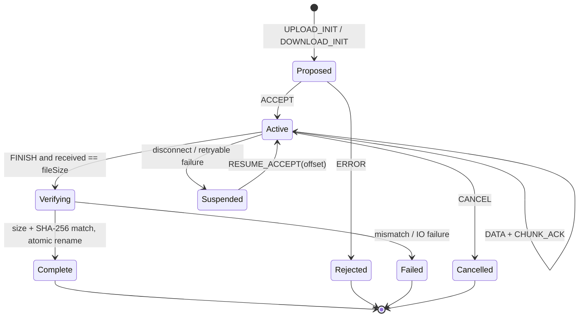

# SFTP-WS v1 应用层协议草案

状态：**Draft / Phase 1 subset implemented**。名称 `SFTP-WS` 仅为本实验协议名，不应与 SSH File Transfer Protocol（通常也缩写 SFTP）混淆；最终报告可改用更不易混淆的 `UCAS-SFT/1`。

## 1. 设计目标

- 在一条长期 WSS 连接上复用控制请求和多个文件任务。
- 明确消息边界、文件大小、偏移和完成确认，不以断开连接表示 EOF。
- 能关联请求、任务和错误，支持重试、重连、并发与后续断点续传。
- 文件分块流式传输，接收端可限制资源并施加背压。
- TLS 保护线路；每块和整文件 SHA-256 发现内容损坏或错误拼接。

## 2. WebSocket 映射

WebSocket 每条 message 对应一个 `SFTP-WS` frame，不允许一个协议 frame 横跨多个 WebSocket message。底层 WebSocket 自身可能进行帧分片，库负责重组；业务层只处理完整 message。

- **文本 message**：控制帧，UTF-8 JSON；上限 64 KiB。
- **二进制 message**：100 字节固定头 + `metadataLength` 字节 UTF-8 JSON + `payloadLength` 字节原始数据。
- 禁用 `permessage-deflate`，避免压缩资源消耗和敏感信息压缩侧信道；文件本身常已压缩。

## 3. 控制帧逻辑头

```json
{
  "version": 1,
  "type": "HEARTBEAT_PING",
  "requestId": "550e8400-e29b-41d4-a716-446655440000",
  "timestamp": 1794384000000,
  "payload": { "nonce": "b510..." }
}
```

| 字段 | 类型 | 约束与语义 |
| --- | --- | --- |
| `version` | integer | 当前为 1；在 `HELLO` 阶段协商，不兼容版本拒绝连接 |
| `type` | enum string | 消息类型；未知类型返回 `UNSUPPORTED_MESSAGE` |
| `requestId` | string | 1–128 个白名单字符；请求与响应相同；事件使用新 ID |
| `timestamp` | non-negative safe integer | 发送端 Unix epoch 毫秒，用于审计，不单独作为重放防护 |
| `payload` | object | 按消息类型校验，拒绝缺字段、错类型和超限值 |

Phase 1 已实现：`HELLO`、`HELLO_ACK`、`HEARTBEAT_PING`、`HEARTBEAT_PONG`、`ERROR`。

Phase 2/3 计划增加：`AUTH_REQUEST/RESULT`、`LIST_REQUEST/RESULT`、`UPLOAD_INIT/ACCEPT`、`DOWNLOAD_INIT/ACCEPT`、`CHUNK_ACK`、`TRANSFER_FINISH/COMPLETE/CANCEL`。

## 4. 二进制数据帧固定头（网络字节序，大端）

```text
 0                   1                   2                   3
 0 1 2 3 4 5 6 7 8 9 0 1 2 3 4 5 6 7 8 9 0 1 2 3 4 5 6 7 8 9 0 1
+-------------------------------+-------+-------+---------------+
|            Magic              | Ver   | HLen  |  MessageType  |
+---------------+---------------+--------------------------------+
|     Flags     |   ErrorCode   |      Request ID (16 bytes) ... |
+---------------+---------------+--------------------------------+
| Request ID ...                |      Transfer ID (16 bytes) ...|
+---------------------------------------------------------------+
| Transfer ID ...                                               |
+---------------------------------------------------------------+
|                     File Size (uint64)                         |
+---------------------------------------------------------------+
|                     Offset (uint64)                            |
+-------------------------------+-------------------------------+
|      Payload Length (u32)     |      Metadata Length (u32)    |
+---------------------------------------------------------------+
|                Payload SHA-256 (32 bytes)                      |
+---------------------------------------------------------------+
|                     ... (total header 100 bytes)               |
+---------------------------------------------------------------+
```

| Offset | 长度 | 字段 | 说明 |
| ---: | ---: | --- | --- |
| 0 | 4 | magic | ASCII `SFT1`，快速拒绝错协议 |
| 4 | 1 | version | `1` |
| 5 | 1 | headerLength | 固定 `100`；为后续扩展保留 |
| 6 | 2 | messageType | 例如 `0x0201 DATA` |
| 8 | 2 | flags | `FINAL`、`ACK_REQUIRED`、`RETRANSMIT`；未知必选位拒绝 |
| 10 | 2 | errorCode | 成功为 0；错误码命名空间，数据帧通常为 0 |
| 12 | 16 | requestId | UUID 的 128 位二进制形式；全零表示无请求关联 |
| 28 | 16 | transferId | 服务端签发的任务 UUID；初始化前为全零 |
| 44 | 8 | fileSize | 声明的整文件字节数；`uint64`，受服务端配额上限约束 |
| 52 | 8 | offset | 本 payload 在文件中的绝对字节偏移 |
| 60 | 4 | payloadLength | 当前原始数据长度，不得超过协商 chunk 上限 |
| 64 | 4 | metadataLength | 紧随头部的 JSON 元数据长度，设置小上限 |
| 68 | 32 | payloadSha256 | 当前 payload 的 SHA-256；无 payload 时为全零 |

总消息长度必须严格等于 `headerLength + metadataLength + payloadLength`。解析器先验证魔数、版本、长度和上限，再分配/读取正文；任何整数溢出、长度不一致、偏移越界或摘要不符均拒绝。

## 5. 任务不变量与状态机



关键不变量：

1. 未成功认证的连接不能创建文件任务。
2. `transferId` 只属于一个已认证用户和一个方向；不能跨连接冒用，恢复时需重新授权。
3. 顺序模式下仅接受 `offset == acknowledgedOffset`；恢复偏移由服务端已持久化长度决定，不信任客户端声称值。
4. `offset + payloadLength <= fileSize`，所有运算先检查溢出。
5. 只有精确收到 `fileSize` 字节且整文件 SHA-256 匹配，临时文件才原子提交并发送 `TRANSFER_COMPLETE`。
6. `ERROR.retryable` 只表示协议建议；客户端仍执行有次数上限和退避的重试。
7. 完成、失败或取消都不关闭 WebSocket；连接继续处理心跳和其他任务。

## 6. 连接协商与心跳

- WebSocket 建立后，客户端第一条消息必须是 `HELLO`；服务端用 `HELLO_ACK` 返回连接 ID、心跳周期和超时。
- 服务端每 15 秒发送带随机 `nonce` 的 `HEARTBEAT_PING`，客户端立即以同 `requestId`/`nonce` 回复 `HEARTBEAT_PONG`。
- 45 秒无有效 PONG 时服务端终止僵死连接。客户端使用 1、2、4、8、10 秒封顶并带随机抖动的重连策略。
- 正式实现会校验未决 nonce，防止任意 PONG 刷新存活时间；Phase 1 目前只验证 nonce 字段存在，这是已知待改进项。

## 7. 错误语义（草案）

| 范围 | 示例 | 是否重试 |
| --- | --- | --- |
| `1xxx` 协议 | `1001 INVALID_MESSAGE`, `1002 VERSION_UNSUPPORTED` | 通常否 |
| `2xxx` 认证授权 | `2001 AUTH_REQUIRED`, `2003 FORBIDDEN` | 重新认证后可能 |
| `3xxx` 路径/文件 | `3001 INVALID_PATH`, `3004 NOT_FOUND`, `3007 HASH_MISMATCH` | 视情况 |
| `4xxx` 资源 | `4001 RATE_LIMITED`, `4002 QUOTA_EXCEEDED`, `4003 TOO_MANY_TASKS` | 有退避时可能 |
| `5xxx` 服务端 | `5001 IO_ERROR`, `5002 TEMPORARY_UNAVAILABLE` | 由 `retryable` 指示 |

错误响应沿用原 `requestId`，与任务相关时携带 `transferId`；对外消息不泄露宿主绝对路径、SQL、堆栈或密钥材料。

## 8. 安全说明

协议不自创密码算法。WSS 使用成熟 TLS 实现；应用摘要用 SHA-256；密码存储使用专用 KDF。摘要不提供发送者身份，因此认证、授权和 TLS 仍是必要条件。生产服务还必须校验 WebSocket `Origin`、限制 Upgrade/连接速率、控制最大 payload、关闭未协商或空闲连接，并审计认证与文件操作。

